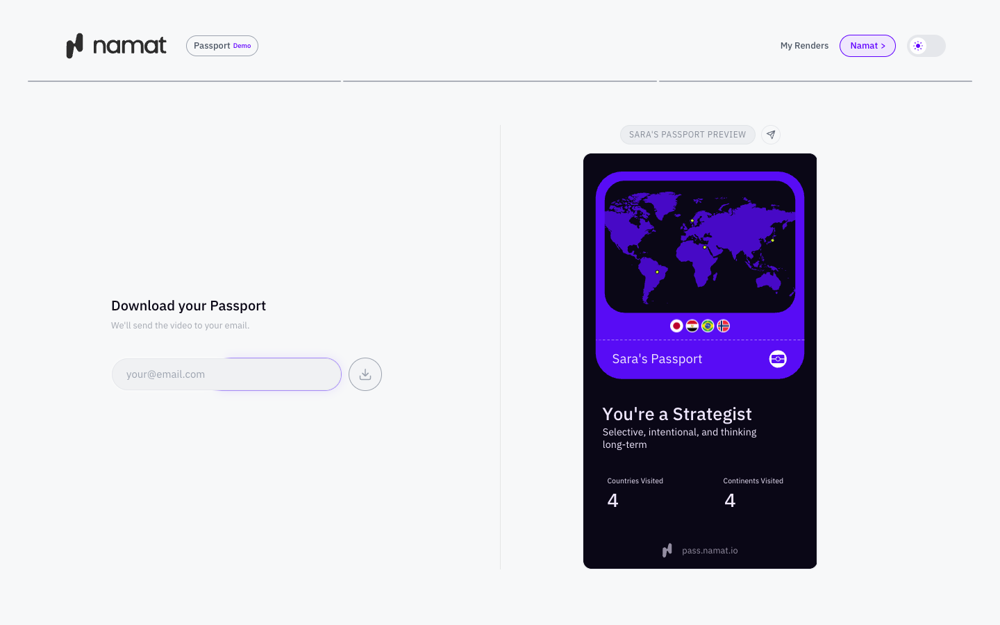

# Namat Passport

A web app that turns the places you've been into a shareable animated passport. You enter your name and the countries you've visited, watch your passport build in the browser, and can then have it rendered to video and sent to your email.



This repository is shared as a case study of the product's front end and its API server.

## How it works

1. **Name.** The name appears on the passport.
2. **Countries.** Autocomplete across 194 countries, with a live world map.
3. **Passport.** A Lottie animation plays through Remotion's in-browser player, filled in with the user's name, flags, stats, and archetype.
4. **Download.** The user enters an email address, a render job starts, and the app polls its status until the video is ready.

### Archetypes

Each passport gets an identity such as *Nomad*, *Strategist*, or *Connector*. It comes from the geography of the user's selection, not from a quiz. [`src/utils/archetypeSelection.js`](src/utils/archetypeSelection.js) works out the country count, continents visited, centroid, and the largest Haversine distance between any two countries. It then applies the ordered rules in [`archetypes.json`](archetypes.json), where the first match in the hierarchy wins.

The same React composition drives the browser preview and the rendered video, so the two match.

## Run it locally

Requires Node 20 or newer.

```bash
npm install
npm run dev
```

Open http://localhost:5173. The full flow through to the animated preview works with no configuration.

| Command | What it does |
| --- | --- |
| `npm run dev` | Start the Vite dev server |
| `npm test` | Run the unit tests |
| `npm run build` | Build for production |
| `npm start` | Serve the build and the API with Express |

## What's in this repo

| Path | Contents |
| --- | --- |
| [`src/PassportDashboard.jsx`](src/PassportDashboard.jsx) | The main multi-step interface |
| [`src/remotion/PassportComposition.jsx`](src/remotion/PassportComposition.jsx) | The passport animation |
| [`src/utils/`](src/utils) | Archetype selection and helpers |
| [`server.js`](server.js) | Express server: static hosting and the user and render APIs |
| [`shared/`](shared) | API client, input validation, auth, and database code |
| [`archetypes.json`](archetypes.json), [`countries.json`](countries.json) | Archetype rules and country data |

**Stack:** React 19, Vite, Tailwind CSS, Remotion, Lottie, GSAP, Express, Postgres, Magic (passwordless email login), AWS S3.

## What's not in this repo

The video render service and its cloud infrastructure aren't included, so **Download** and **My Renders** won't work locally. These features need the variables listed in [`.env.example`](.env.example) and a compatible render API.

## License

Copyright © Namat Studio. All rights reserved. The code is published for reference and isn't licensed for reuse. The Namat name and logo are not licensed for any use.
